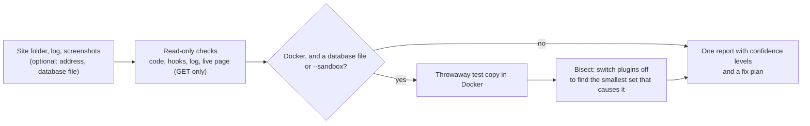
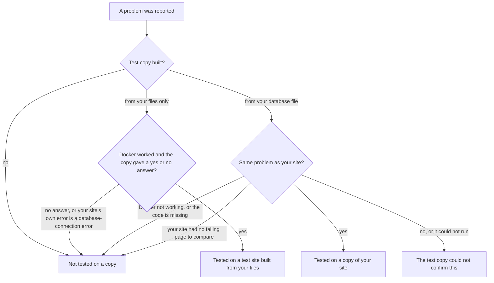

<div align="center">

# wp-issue-diagnoser

**Find the likely cause of a WordPress problem. It reads a copy of your site and changes nothing.**

The command is called `wp-issue-diagnoser`. From the repository folder you run it with `npm run diagnose`. `npm run guard` is the advanced entry: the older scan commands, the issue subcommands and the doctor (see the [technical guide](./docs/GUIDE.md)).

 

[What it does](#what-this-does) · [Never does](#what-it-never-does) · [Reading a report](#how-to-read-the-report) · [Limits](#limits) · [Install](#install) · [Quick start](#quick-start) · [Troubleshooting](#troubleshooting) · [Testing](#testing)

</div>

You tell it what is wrong ("the shop page is blank") and where the site's folder is. It looks at a copy of the files and the error log, can load a few pages of the live site, and can build a throwaway test copy in Docker to try the problem there. You get one report that says how sure it is, and a short plan of what to do next. It never applies a fix to your site.

## What this does

| Feature | What you get |
|---|---|
| Reads a copy of your site | A copy of your files and your own error log are read, never the original. The site folder is not written to. |
| Finds the likely cause of ONE reported problem | A short list of the plugin, theme or setting most likely at fault, each with how sure it is. |
| Reads screenshots | Text in screenshots is read with OCR and used as clues. |
| Reads your code | A real PHP parser looks for duplicate functions, hooks removed at the wrong priority, missing guards and more. |
| Looks at the live site (optional) | A few pages are loaded like a visitor would, one at a time and slowly. It stops at the first sign of protection. |
| Builds a test copy in Docker (optional) | A throwaway copy of the site, from your files or from a database export. The problem is tried there, and plugins are switched off one by one until the smallest set that causes it is found. |
| Writes the report | A page you open in a browser, a Markdown version, and a plan (FIX-PLAN.md) in which every step says how to undo it. |
| Checks a list of 53 known problems | Each one is marked PASS, FAIL or NOT CHECKED, with a reason. NOT CHECKED is never shown as a pass. |
| Classic scan (older commands) | A PDF report for the admin on plugin conflicts, dependencies and exposure, and a task file for a coding assistant. See the [technical guide](./docs/GUIDE.md). |

### How it works



Nothing is changed on your site at any step. The test copy is removed when the run ends, unless you ask to keep it (`--keep-sandbox`).

## What it never does

- It never writes to your site folder. It only reads it. Its copy of the site and its reports go into its own report folder, and that folder is never inside your site folder.
- It reads your site's files and runs a PHP syntax check (`php -l`) on them. The older scan commands can also run WP-CLI against your site, with plugins and themes skipped: only listing commands and `SELECT` queries. With `--export-db` (not for a site marked live) it also runs one WP-CLI database export of your site into a file inside its own sandbox folder; that is a read of your database and writes nothing to your site. Your site's own code is run only inside the Docker test copy.
- It never changes your website. With an address, it only loads pages, like a visitor's browser: read-only requests (GET), one page at a time, with a pause between pages. It never logs in, clicks, types or sends a form there, so it only sees what any visitor can see.
- It stops at the first sign that the website is protecting itself (a "too many requests" answer or a challenge page). It does not try again, and it sends nothing more to that website for 30 minutes.
- A website you mark as live is visited only after you type its name (its domain) when asked, or give `--authorized`. The mark comes from `--env` or from your confirmed answer.
- A site marked live is never copied with its database: the database file is dropped. A test copy from a database file is built only for a site marked local or staging. In the wizard, a site with no address and no `--env` counts as local.
- It never applies a fix to your site. Suggested changes are written into files and a plan, and a person makes them, on a copy first. A fix may be tried inside a test copy, to see whether it helps.
- It never asks an AI. No AI service is called. In issue mode, the same input gives the same findings, apart from the timestamp, the issue id and the folder path.
- It sends nothing to other services on its own. Checking plugin versions at wordpress.org or WPScan happens only when you switch it on for a project (`outsideLookups`, for the older scan commands). Apart from loading your own website's pages and one DNS lookup of its host name, only these use the internet: the one-time setup commands (`npm ci`, `npm run setup-browser`, `npm run setup-ocr`, `npm run setup-sandbox`), `npm run verify-knowledge`, and the opt-in `outsideLookups` above. Every case is listed in [the safety rules](./docs/SAFETY.md).
- Your database file is only read. The tool makes its own owner-only copy of it, streams that copy into the throwaway test database, rewrites every real user account into a dummy account after the import, the read of the list of active plugins and the payment-gateway check (the web container stays stopped until the rewrite is done), and deletes its copy of the file when the import ends. Every account becomes a dummy account. One dummy administrator gets a password that is shown once on the screen and never saved.

The test copy has limits on its network. Built from a database file, the WordPress in the copy has no route to the internet (a front proxy is the only container with a route out). Built without one (`--sandbox`), it can still open a direct connection to an internet address written as numbers (an IP address). WordPress's own web requests, host-name lookups and e-mail are blocked. So build test copies only of sites you own, with plugins you trust. The full rules, and the audit of the first version, are in [the safety rules](./docs/SAFETY.md) and [the audit](./docs/plugin-guard-audit.md).

## How to read the report

The top of the report is plain sentences, so you can forward it. Technical detail (files, lines, the error text) is further down, under "For a developer".

The STATUS line counts what was found, for example "1 likely cause (not confirmed) · 1 thing to check · 0 confirmed". A "Likely cause (not confirmed)" comes from your log and the code, but no second, independent test proved it. A "Confirmed cause" is backed by two independent checks. "Something else to check (probably not the crash)" is worth a look, but probably did not cause the problem.

A heading then says how far the testing went. There are four levels:

| Level (heading in the report) | What it means |
|---|---|
| Tested on a copy of your site | A test copy built from your database showed the same problem as your site: the same page, the same kind of failure and the same error. This is the strongest result. In a weaker case ("status only") the copy showed only the same kind of failure on the same page, with no error message to compare; the report then says "this is weaker evidence". |
| Tested on a test site built from your files | A test copy built from your files only (no database file) was tried and gave an answer (yes or no). It has none of your site's data, so it is weaker. If it gave no answer, or your site's own error is a database-connection error, the report says "Not tested on a copy" instead. |
| Not tested on a copy | No test copy was used, or one was built but your site had no failing page to compare it with (then the label NOT CONFIRMED is shown). The report lists what was missing (a database export file, Docker, the site's code, or a page that fails on your site to compare with), or says "You chose not to build a test copy." What it says then comes from reading your log and the code, and is labelled NOT TESTED. |
| The test copy could not confirm this | A test copy was tried, but it could not run, or it did not show the same problem. |



Two more things in the report:

- **NOT CONFIRMED** means a test copy was built and showed the reported error in its log, but your site had no failing page to compare with, so the copy does not confirm the report.
- **"How close the copy is"** appears when a test copy was built. It sorts what was compared into "Matched", "Did not match", "Not known" and "Not covered in this version" (outside services, the web server's own rules, file permissions, cron jobs and so on).

"What was checked" counts the checks: pass, fail, not checked, and also noticed (something was found, but nothing ties it to this problem). Nothing in the report is done for you: each case has a "What to do" line, and the plan file lists the steps, each with how to undo it.

**Example from a test case, not a real site.** This is the top of a report for a made-up site in which two plugins both define a function `my_helper()` (the output is shortened):

```text
VERDICT: Confirmed cause found in your logs
  How sure we are: fairly. The error is in your log and the code was re-read, but it was not seen failing on the site.

White screen after activating Plugin B

STATUS  0 likely cause · 0 thing to check · 1 confirmed
        Looked at: your log, the code. Not looked at: the live page, a throwaway test copy.
        PHP: not stated.

NOT TESTED ON A COPY
        What a test on a copy of your site needs, and was missing:
          - a database export file of your site (.sql or .sql.gz)
        NOT TESTED: what this report says comes from reading your log and the code. It was not tried on a copy of your site.

CASE 1  CONFIRMED CAUSE
  Components: the plugin Plugin A 1.0.0 and the plugin Plugin B 1.0.0
  Where:
    - wp-content/plugins/plugin-a/plugin-a.php, line 8
    - wp-content/plugins/plugin-b/plugin-b.php, line 8
  Why: The function my_helper() is defined twice (...), and PHP stops when both load. Kind of problem: two plugins clash.
  How sure:
    - Confirmed by two independent checks. Not yet tested on a copy of your site.
```

## Limits

- **Not proven on many real sites.** The tool is in active development. It is checked by an automated test suite on test fixtures, and passing tests show that the checks do what the tests describe, not that every WordPress site will be analysed correctly. How often the likely cause is right on a wide range of real sites is **not measured yet**.
- **One PHP version per test copy.** The version is chosen once from the one you state or the tool detects. The default is PHP 8.3, and images are pinned for PHP 8.2, 8.3 and 8.4. PHP 7.4, 8.0 and 8.1 have no pinned image: the tests for them skip. For 8.0 and 8.1 a copy uses the nearest available 8.x version, and for 7.4 it uses the default (8.3); the report says which, and "not matched" when it is not the same version. The problem is not re-run on other PHP versions.
- **The page probe sends GET requests only.** It never logs in, so a problem that needs a logged-in user is "could not test" until a test copy exists.
- **A test copy shows only what a copy can show.** Outside services, the web server's own rules, file permissions and cron jobs are listed as "Not covered in this version".
- **Without a database file** a test site is built from your files only, with no real data.
- **The database scrub rewrites only the tables it knows** (users, some profile fields, comment author fields, the admin e-mail, WooCommerce customer and order data, and options whose names look like secrets). Post and comment text, order notes, other option values and other plugins' tables are copied as they are. Build copies only of sites you own.
- **Patches cover four patterns** (a hook removed at the wrong priority, a missing `function_exists` or `class_exists` guard, a custom copy replacing a core script or style, a dependency on a handle nobody registers). Everything else is "needs a human".
- **Bisection cannot explain a symptom that is present with no plugins at all.** The report then says so and blames no plugin.
- **A check that cannot run says "Not run", never "clean".** For example the vulnerability check ships without data.

More limits, with their reasons, are in the [technical guide](./docs/GUIDE.md).

## Requirements

| Needed | For what | Notes |
|---|---|---|
| Node.js 20.12 or newer, and npm | Everything | Required. |
| Chromium browser for Playwright | The live page probe and the PDF report | Installed with `npm run setup-browser`. |
| PHP command line | The `php -l` syntax check | Optional; without it that check says "NOT RUN". |
| Docker (rootless is best) | The throwaway test copy | Optional; without it only the static analysis and the page probe run. Images are pulled by `npm run setup-sandbox` (not tested here by hand). |
| Tesseract language data (one file) | Reading text in screenshots | Optional; downloaded by `npm run setup-ocr`. |

It was developed and tested on Linux. Other systems are not tested.

## Install

The repository is private for now, so you need access to it first. Then:

```bash
git clone <the repository address you were given>
cd wp-issue-diagnoser
npm ci                      # install the packages
npm run setup-browser       # download Chromium for the page probe and the PDF
npm run setup-ocr           # optional: the language file for reading screenshots
npm run setup-sandbox       # optional: pull the Docker images (needs Docker; not tested here by hand)
npm run guard -- doctor     # check what is installed
```

`npm run guard -- doctor` lists each prerequisite with a tick or a dash and what to do about it.

## Quick start

1. **See it work on a made-up site (offline, a few seconds):**

   ```bash
   npm run demo
   ```

   It builds a fake site where two plugins define the same function, reports "white screen after activating Plugin B", investigates it and prints the verdict, the cause and a patch. It ends with "The original site was not touched".

2. **Run it on your own site.** Give it the problem and the folder that contains `wp-content` (or `wp-content` itself):

   ```bash
   npm run diagnose -- --description "White screen after activating Plugin B" --root /path/to/wordpress --yes
   ```

   It prints the report as in the example above and saves it in a report folder (by default the `issues/` folder of this package, or the place given with `--out`) and prints where. Open the `issue.html` file it names in a browser. The plan is `FIX-PLAN.md` next to it.

3. **Or let it ask you.** With no options it asks one question at a time (the problem, screenshots, the address, the folder from a numbered list):

   ```bash
   npm run diagnose        # not tested here: it needs a terminal to answer in
   ```

4. **Try the problem in a throwaway copy** (needs Docker and `npm run setup-sandbox`; the commands in this step are not tested here by hand, the Docker test suites cover the database copy): add a database export of the site and a test copy is built for you when the site is not marked live:

   ```bash
   npm run diagnose -- --description "Checkout is blank" --root /path/to/wordpress --db-dump /path/to/site.sql   # not tested here by hand
   ```

All options of `wp-issue-diagnoser`:

| Option | What it is |
|---|---|
| `--description "<text>"` | What is wrong (required). |
| `--root <folder>` | The WordPress folder, or its `wp-content` folder (required). |
| `--url <address>` | The website, to look at it from outside. |
| `--env local\|staging\|live` | What kind of site `--url` is. A live site also needs `--authorized`. |
| `--authorized` | You have the owner's permission to visit a live site. |
| `--php <version>` | For example 8.1. |
| `--images <paths>` | Screenshots: files or folders, separated by commas. |
| `--log <file>` | A log file instead of the one found in your site. |
| `--sandbox` | Also test in a throwaway copy built from your files (not tested here by hand). |
| `--db-dump <file>` | A database export (`.sql` or `.sql.gz`): a test copy is built from it (not tested here by hand). |
| `--max-size-mb <n>` | Size cap for the site copy and the unpacked database file. |
| `--no-replica` | Never build a test copy. |
| `--out <folder>` | Where the reports go. |
| `--yes` | Never ask; a missing required value is an error. |

`npm exec -- wp-issue-diagnoser --help` prints the same list. The technical guide covers the older scan commands and issue mode in detail.

## Troubleshooting

<details>
<summary>Docker is not installed, not running, or you may not use it</summary>

The report then says what was missing under "Not tested on a copy". The messages you may see:

- `Docker is not installed. The sandbox needs it; without it only the static analysis and the live probe run.`
- `Docker is installed but its daemon cannot be used (permission denied on the Docker socket: this user is not in the "docker" group): ...`

Start Docker, or add your user to the `docker` group (or use rootless Docker), and run again. `npm run guard -- doctor` shows the state.

</details>

<details>
<summary>The Docker images are missing</summary>

`The pinned sandbox image(s) ... are not present locally. wp-issue-diagnoser never pulls on its own: run  npm run setup-sandbox`

Run `npm run setup-sandbox` once (it needs the Docker daemon and downloads the images by their digest; not tested here by hand).

</details>

<details>
<summary>The browser (Chromium) is missing</summary>

`Playwright ... is installed, but its Chromium browser is not. Run once in this folder: npm run setup-browser`

If Playwright itself is missing, the message says `Run once in this folder: npm ci, then: npm run setup-browser`. Without the browser you still get the HTML copy of a classic report, but no PDF and no page probe.

</details>

<details>
<summary>Screenshots are not read</summary>

`OCR language data is not installed (...). Run once in this folder: npm run setup-ocr` (it downloads one file of about 4 MB and checks its SHA-256). Without it the screenshots are kept with the report but their text is not read.

</details>

<details>
<summary>The test copy uses another PHP version than my server</summary>

The report says which PHP version the copy used and where the version came from, for example `PHP 8.1 (from Site Health): PHP 8.1 requested, 8.2 used (nearest available; the PHP 8.1 image is not pinned yet)`, or `... used (not matched; ...)`.

A test copy uses one PHP version. Images are pinned for 8.2, 8.3 and 8.4. If the version you need is pinned but not on this computer, the report names the command, for example `npm run setup-sandbox -- --php 8.2` (not tested here by hand). For 8.0 and 8.1 there is no pinned image yet, so the nearest 8.x version is used; for 7.4 the default (8.3) is used and the report says "not matched".

</details>

<details>
<summary>"has a wp-content folder, but it has no plugins and themes folders inside"</summary>

`--root` points at a folder that has a `wp-content` folder with neither a `plugins` nor a `themes` folder in it. Point `--root` at the real WordPress folder.

</details>

## Testing

The checks are plain scripts, run with `npm test` (the offline suites, then the Docker suites), or one at a time with `npm run selftest:docs` and so on. The details, the full-run script and every skipped check are in [docs/TESTING.md](./docs/TESTING.md).

Latest full run (valid): 75 suites, 4478 PASS, 0 FAIL, 7 SKIP, on one machine, on 2026-11-16. The skips are listed with their reasons in the testing document; they include PHP 7.4, 8.0 and 8.1 (no pinned image) and the git checks that cannot run in a snapshot.

## Project structure

```text
scripts/    the commands (plugin-guard.js, guard.js), setup scripts and every test suite
lib/        shared code: the questions, reports, site copy, WP-CLI allow-list
issue/      issue mode: evidence, code analysis, hypotheses, test copy, validation, results
probe/      the read-only, paced live page probe
checks/     the classic scan checks
agents/     the classic three-agent workflow
data/       pinned data: sandbox images, checkpoints, knowledge files
docs/       documentation (below)
```

More documentation (the full map of every document is [docs/README.md](./docs/README.md)): [technical guide](./docs/GUIDE.md) · [safety rules](./docs/SAFETY.md) · [what is detected](./docs/COVERAGE.md) · [architecture](./docs/ARCHITECTURE.md) · [report design](./docs/REPORT-SPEC.md) · [test copy design](./docs/TEST-COPY-SPEC.md) · [testing](./docs/TESTING.md) · [third-party notices](./THIRD-PARTY.md)

## Licence

MIT, see the [LICENSE](./LICENSE) file. Copyright (c) 2026 Sahil Singla.
